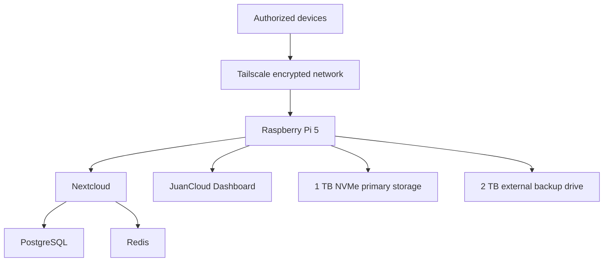

# Raspberry Pi Home Cloud

A self-hosted private cloud and backend development server built with a Raspberry Pi 5, Ubuntu Server, Docker, Nextcloud, PostgreSQL, Redis, Tailscale, and automated external storage.

## Project Overview

This project transforms a Raspberry Pi 5 into a secure home server capable of:

- Hosting a private Nextcloud instance
- Synchronizing files across computers and mobile devices
- Running containerized backend applications
- Providing a private system-monitoring dashboard
- Storing backups on a dedicated external drive
- Recovering services automatically after a reboot
- Supporting future portfolio and API deployments

## Hardware

| Component | Purpose |
|---|---|
| Raspberry Pi 5, 8 GB RAM | Main ARM64 server |
| Argon NEO 5 M.2 NVMe case | Cooling and NVMe integration |
| Kingston NV3 1 TB NVMe SSD | Operating system, applications, and primary data |
| WD Elements 2 TB external drive | Dedicated backup storage |
| SanDisk Ultra 32 GB microSD | Installation and recovery media |
| Official Raspberry Pi 27 W USB-C power supply | Stable power delivery |
| Cat 6 Ethernet cable | Gigabit network connection |
| Micro-HDMI to HDMI cable | Optional initial local setup |

A monitor and USB keyboard were used only during the initial installation. The server is now administered remotely through SSH.

## Software Stack

- Ubuntu Server 24.04 LTS ARM64
- Docker Engine and Docker Compose
- Nextcloud
- PostgreSQL
- Redis
- Node.js and Express
- Tailscale
- UFW firewall
- OpenSSH
- ext4 backup storage

## Architecture



## Storage Layout

| Storage | Role |
|---|---|
| 1 TB NVMe | Ubuntu, Docker, Nextcloud, databases, dashboard, and backend projects |
| 2 TB external drive | Backups of Nextcloud, databases, and server configuration |
| 32 GB microSD | Recovery media |

The external drive is mounted persistently at:

```text
/srv/backups
```

Backend projects are stored under:

```text
/srv/projects
```

## Nextcloud Deployment

Nextcloud runs as a Docker Compose stack containing:

- Nextcloud Apache application
- PostgreSQL database
- Redis cache
- Nextcloud cron service

The application listens only on the host loopback interface. It is not directly exposed through the router.

Secrets are stored in a local `.env` file that is excluded from Git. Only `.env.example` is included in this repository.

## JuanCloud Dashboard

The private dashboard is built with Node.js and Express. It displays:

- CPU usage
- Memory usage
- Processor temperature
- System load
- Server uptime
- ARM64 system information
- NVMe usage
- External backup-drive usage

The dashboard container:

- Runs as a non-root user
- Uses a read-only filesystem
- Drops all Linux capabilities
- Prevents privilege escalation
- Receives only read-only access to dedicated metrics directories
- Does not mount the Docker socket
- Does not expose logs, secrets, IP addresses, or administrative controls

## Security

Security controls include:

- SSH public-key authentication
- Password authentication disabled
- Root SSH login disabled
- UFW enabled with incoming traffic denied by default
- Tailscale access restricted to authenticated devices
- HTTPS provided through Tailscale Serve
- Docker services bound to localhost
- Separate PostgreSQL and Redis credentials
- Automatic Ubuntu security updates
- No router port forwarding
- No public Tailscale Funnel
- Secrets excluded through `.gitignore`

## Recovery Testing

The Raspberry Pi was rebooted to verify automatic recovery. The following components returned successfully:

- Ubuntu Server from NVMe
- External backup drive mount
- Docker Engine
- Nextcloud
- PostgreSQL
- Redis
- Nextcloud cron
- JuanCloud Dashboard
- Tailscale Serve routes

## Repository Structure

```text
.
├── dashboard/
│   ├── public/
│   ├── Dockerfile
│   ├── compose.yaml
│   ├── package.json
│   ├── server.js
│   └── storage.js
├── docs/
├── images/
│   ├── assembly/
│   └── screenshots/
├── nextcloud/
│   ├── .env.example
│   └── compose.yaml
├── scripts/
├── .gitignore
├── LICENSE
└── README.md
```

## Current Status

- [x] Ubuntu Server installed on NVMe
- [x] SSH key authentication configured
- [x] UFW firewall enabled
- [x] Docker installed and tested
- [x] Nextcloud deployed
- [x] PostgreSQL and Redis configured
- [x] Private remote access configured
- [x] iPhone synchronization tested
- [x] External backup drive configured
- [x] Initial backup completed
- [x] Monitoring dashboard deployed
- [x] Automatic recovery tested
- [ ] Automated scheduled backups
- [ ] Restore procedure testing
- [ ] Public portfolio deployment
- [ ] Final documentation and photographs

## Privacy Notice

This repository intentionally excludes:

- Passwords and environment files
- SSH private keys
- Tailscale private addresses and domain names
- Nextcloud user data
- Database contents
- Backup archives
- Public IP addresses
- Hardware serial numbers

## Author

Juan Carlos Matos Soriano  
Computer Science student and backend developer
