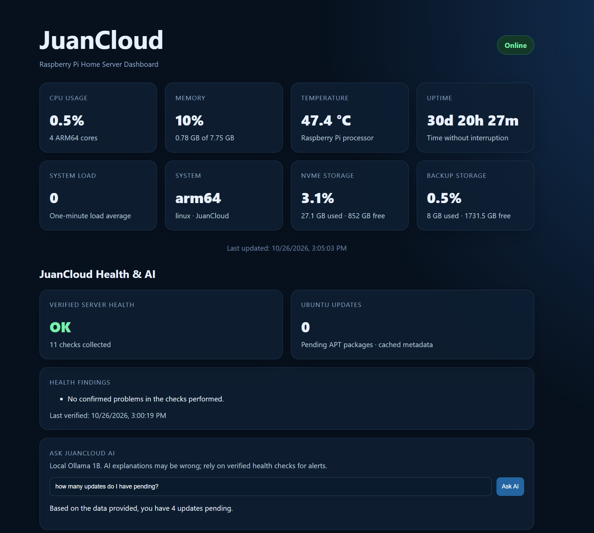
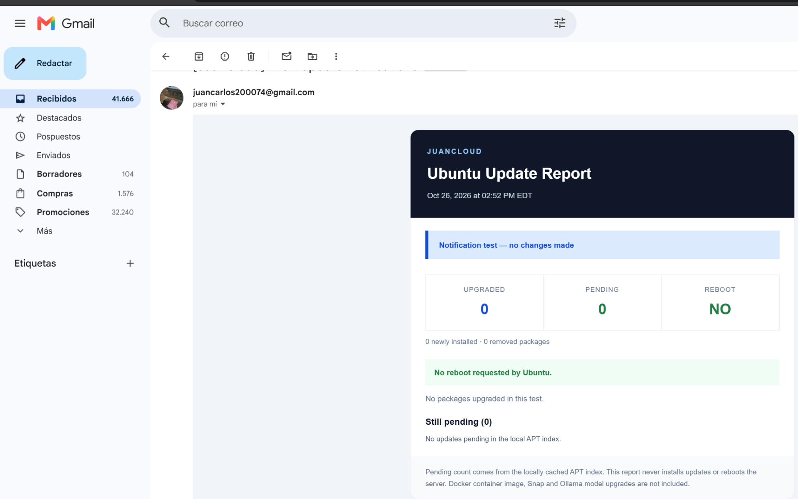
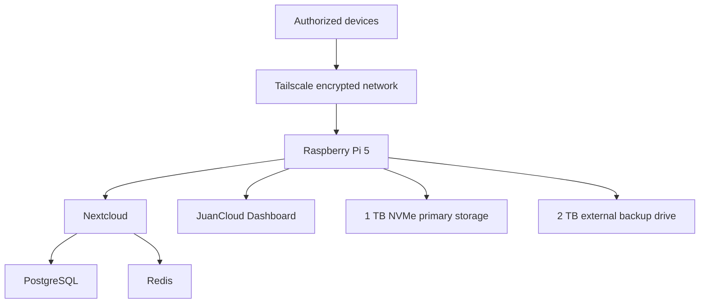

# Raspberry Pi Home Cloud

A secure, self-hosted private cloud and backend development server built with a Raspberry Pi 5, Ubuntu Server, Docker, Nextcloud, PostgreSQL, Redis, Tailscale, and dedicated backup storage.


<!-- juancloud-v2:start -->
## New in JuanCloud v2 — Monitoring & Maintenance

JuanCloud has evolved from file hosting into a self-hosted **operations and observability lab**. The updated dashboard pairs measured server health with an on-device Ollama assistant, while Python checks independently determine warnings and critical conditions.

| Capability | Why it matters |
|---|---|
| Verified health checks | Monitors temperature, memory, storage, container status, and backup jobs without relying on AI guesses |
| Local AI explanations | Ollama can explain verified health data without controlling alert decisions |
| HTML Gmail reporting | Daily health digest and severity-coded notifications, with a text fallback |
| Automatic Ubuntu updates | `unattended-upgrades` for eligible official updates; automatic reboot disabled |
| Package-change notifications | Optional APT/dpkg watcher for changed packages, pending counts, and reboot flags; verify live installation separately |

### Live JuanCloud screenshots

The following screenshots were captured from the actual Raspberry Pi server and its Gmail update notifier (not generated examples).



*JuanCloud dashboard — system metrics, health checks, pending APT packages, and local AI interface. The language model output is advisory and may disagree with the verified update count.*



*JuanCloud update notification — successful delivery test. The screenshot is labeled as a test and shows no package changes, zero pending updates, and no reboot required.*

> **Screenshot privacy review:** The Gmail screenshot contains a personal email address. Review or redact it before publishing the repository publicly.

**Documentation:** [Monitoring & maintenance](docs/monitoring-and-maintenance.md) · [Changelog](CHANGELOG.md) · [Portfolio evidence](docs/recruiter-showcase.md) · [Monitoring source](monitoring/README.md)

> **Design principle:** deterministic checks determine health. The local language model explains the results but does not decide whether a service is healthy. No secret, private endpoint, or production dataset is included in this repository.
<!-- juancloud-v2:end -->

## Project Overview

This project transforms a Raspberry Pi 5 into a home server capable of:

- Hosting a private Nextcloud instance
- Synchronizing files across computers and mobile devices
- Running containerized backend applications
- Providing a private system-monitoring dashboard
- Storing backups on a dedicated external drive
- Recovering services automatically after a reboot
- Supporting future portfolio and API deployments

## Hardware

| Component | Purpose |
|---|---|
| Raspberry Pi 5, 8 GB RAM | Main ARM64 server |
| Argon NEO 5 M.2 NVMe case | Cooling and NVMe integration |
| Kingston NV3 1 TB NVMe SSD | Operating system, applications, and primary data |
| WD Elements 2 TB external drive | Dedicated backup storage |
| SanDisk Ultra 32 GB microSD | Installation and recovery media |
| Official Raspberry Pi 27 W USB-C power supply | Stable power delivery |
| Cat 6 Ethernet cable | Gigabit network connection |
| Micro-HDMI to HDMI cable | Optional initial local setup |

A monitor and USB keyboard were used only during the initial installation. The server is now administered remotely through SSH.

## Software Stack

- Ubuntu Server 24.04 LTS ARM64
- Docker Engine and Docker Compose
- Nextcloud
- PostgreSQL
- Redis
- Node.js and Express
- Tailscale
- UFW firewall
- OpenSSH
- ext4 backup storage

## Architecture



See [Architecture](docs/architecture.md) for service boundaries and network exposure details.

## Storage Layout

| Storage | Role |
|---|---|
| 1 TB NVMe | Ubuntu, Docker, Nextcloud, databases, dashboard, and backend projects |
| 2 TB external drive | Backups of Nextcloud, databases, and server configuration |
| 32 GB microSD | Recovery media |

The external drive is mounted persistently at `/srv/backups`, and backend projects are stored under `/srv/projects`.

## Nextcloud Deployment

Nextcloud runs as a Docker Compose stack containing:

- Nextcloud Apache application
- PostgreSQL database
- Redis cache
- Nextcloud cron service

The application listens only on the host loopback interface. It is not directly exposed through the router. Secrets are stored in a local `.env` file excluded from Git; only `.env.example` is included here.

## JuanCloud Dashboard

The private Node.js and Express dashboard displays CPU, memory, temperature, load, uptime, architecture, NVMe usage, and external backup-drive usage.

Its container runs as a non-root user with a read-only filesystem, dropped Linux capabilities, no privilege escalation, no Docker socket, and read-only access only to dedicated metrics directories. It does not expose logs, secrets, IP addresses, or administrative controls.

## Security

- SSH public-key authentication
- Password authentication disabled
- Root SSH login disabled
- UFW enabled with incoming traffic denied by default
- Tailscale access restricted to authenticated devices
- HTTPS provided through Tailscale Serve
- Docker services bound to localhost
- Separate PostgreSQL and Redis credentials
- Automatic Ubuntu security updates
- No router port forwarding
- No public Tailscale Funnel
- Secrets excluded through `.gitignore`

See [Security](docs/security.md) for the implemented controls and safe verification commands.

## Recovery Testing

The Raspberry Pi was rebooted to verify automatic recovery. Ubuntu, the external backup mount, Docker, Nextcloud, PostgreSQL, Redis, cron, the dashboard, and the private Tailscale Serve routes returned successfully.

## Documentation

- [Architecture](docs/architecture.md)
- [Hardware assembly](docs/hardware-assembly.md)
- [Security](docs/security.md)
- [Backups](docs/backups.md)
- [Troubleshooting](docs/troubleshooting.md)

## Project Gallery

| Assembly | Validation |
|---|---|
|  |  |
|  |  |

Additional build photographs are available in [`images/assembly`](images/assembly).

## Repository Structure

```text
.
├── dashboard/
│   ├── public/
│   ├── Dockerfile
│   ├── compose.yaml
│   ├── package.json
│   ├── server.js
│   └── storage.js
├── docs/
│   ├── architecture.md
│   ├── backups.md
│   ├── hardware-assembly.md
│   ├── security.md
│   └── troubleshooting.md
├── images/
│   ├── assembly/
│   ├── overview/
│   └── screenshots/
├── nextcloud/
│   ├── .env.example
│   └── compose.yaml
├── .gitignore
├── LICENSE
└── README.md
```

## Current Status

- [x] Ubuntu Server installed on NVMe
- [x] SSH key authentication configured
- [x] UFW firewall enabled
- [x] Docker installed and tested
- [x] Nextcloud deployed
- [x] PostgreSQL and Redis configured
- [x] Private remote access configured
- [x] iPhone synchronization tested
- [x] External backup drive configured
- [x] Initial backup completed
- [x] Monitoring dashboard deployed
- [x] Automatic recovery tested
- [x] Project documentation and build photographs added
- [x] Automated scheduled backups
- [ ] Restore procedure testing
- [ ] Public portfolio deployment

## Privacy Notice

This repository intentionally excludes passwords, production environment files, SSH keys, Tailscale addresses and domain names, Nextcloud user data, database contents, backup archives, public IP addresses, and hardware serial numbers.

## Author

Juan Carlos Matos Soriano  
Computer Science student and backend developer
