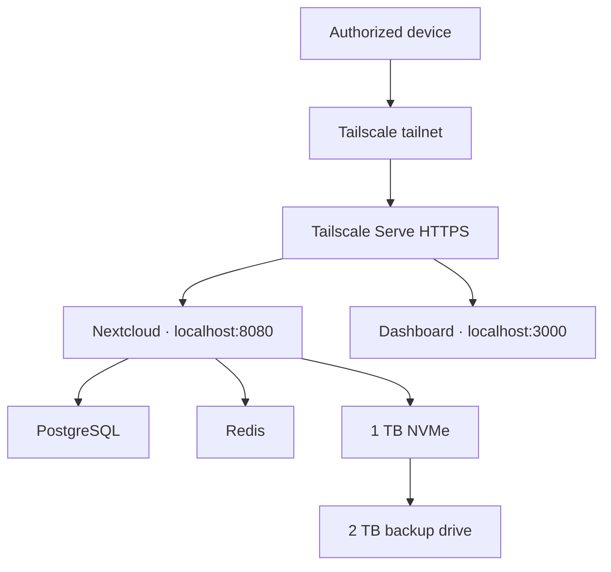

# Architecture

JuanCloud is a private ARM64 home-server platform built around a Raspberry Pi 5. The host runs Ubuntu Server from NVMe and uses Docker Compose to isolate the cloud and monitoring services.

## Service boundaries

| Component | Responsibility | Exposure |
|---|---|---|
| Ubuntu Server | Host OS, storage and networking | SSH through authenticated access |
| Docker Compose | Container lifecycle and isolation | Not exposed |
| Nextcloud | File sync and private-cloud interface | Loopback, proxied by Tailscale Serve |
| PostgreSQL | Nextcloud metadata | Internal Docker network only |
| Redis | File locking and cache | Internal Docker network only |
| Dashboard | Read-only server metrics | Loopback, proxied by Tailscale Serve |
| Tailscale | Private encrypted connectivity | Authorized tailnet devices only |

No router ports are forwarded and Tailscale Funnel is not enabled.

