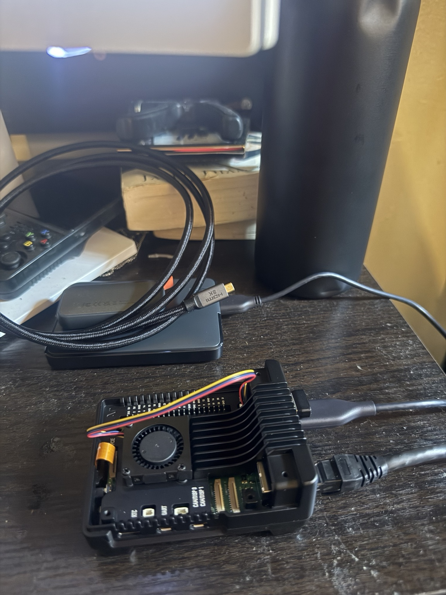
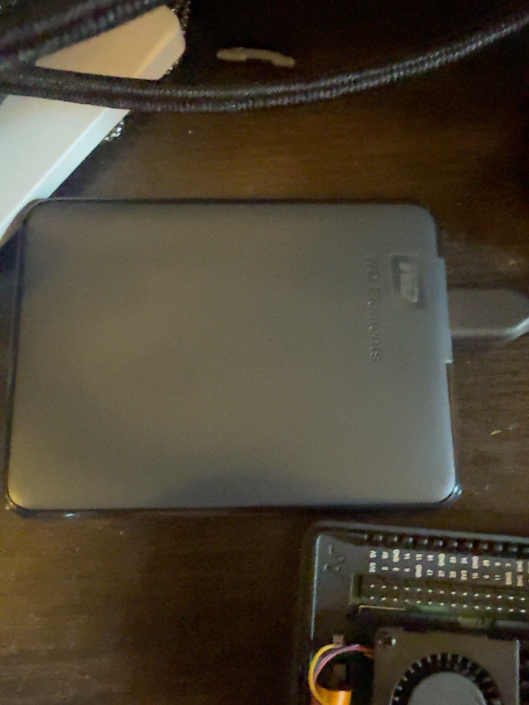

# Hardware Assembly

## Parts used

| Component | Role |
|---|---|
| Raspberry Pi 5, 8 GB | ARM64 compute platform |
| Argon NEO 5 M.2 NVMe case | Enclosure, cooling and PCIe/NVMe integration |
| Kingston NV3 1 TB NVMe | Primary boot and application storage |
| WD Elements 2 TB | External backup target |
| SanDisk Ultra 32 GB microSD | Initial installation and recovery media |
| Official 27 W USB-C supply | Stable 5 V/5 A power |
| Cat 6 Ethernet | Gigabit LAN connectivity |
| Micro-HDMI to HDMI | Temporary local display |

## Assembly sequence

1. Disconnect all power before touching the PCIe ribbon, NVMe or cooling components.
2. Seat the Raspberry Pi in the enclosure without forcing ports or headers.
3. Connect the PCIe ribbon in the orientation specified by the case manufacturer.
4. Install the NVMe drive and secure it with its mounting screw.
5. Apply the supplied thermal pad without leaving protective film attached.
6. Connect the case fan and confirm that cables cannot contact the fan blades.
7. Insert the prepared microSD for the temporary installation phase.
8. Connect Ethernet and video before connecting power.
9. Verify that Linux detects both the microSD and NVMe with `lsblk`.
10. Install Ubuntu Server to NVMe, shut down correctly, remove the microSD and confirm NVMe boot.

## Assembly photographs






## Validation

```bash
findmnt /
lsblk -o NAME,SIZE,FSTYPE,LABEL,MOUNTPOINTS,MODEL
uname -m
```

The root filesystem must resolve to the NVMe device, and the architecture must report `aarch64` or `arm64`.

