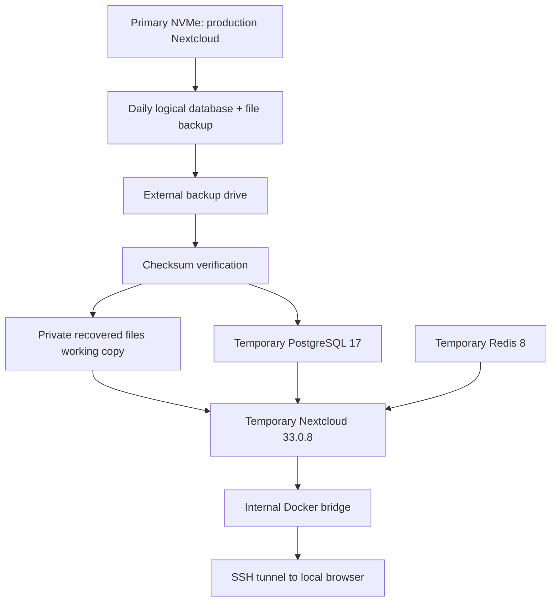

# JuanCloud v3 — Nextcloud disaster recovery

## Objective and scope

Validate that a scheduled Nextcloud backup can be restored into **separate, temporary Docker resources** without stopping or modifying the live installation. This was demonstrated on an operating Raspberry Pi 5 on **October 26, 2026**. It is **application recovery**, not a demonstration of rebuilding the Raspberry Pi from scratch or recovering from loss of the primary NVMe drive.

## Architecture and isolation



**Isolation safeguards:** The recovery scripts use distinct container names, a fresh database volume, an internal Docker bridge, an independent working copy of application files, no published Docker ports, and a randomly generated temporary database password. The temporary Nextcloud config replaces production connection settings, and the original production config and backup archives are not modified. A cleanup trap attempts to remove temporary containers, network, volume, work copy, and credentials; verify the resource lists after each run. Only nonsecret test summaries remain locally.

The scripts rely on **cached production-matching images** (`nextcloud:33-apache`, `postgres:17-alpine`, `redis:8-alpine`) and existing healthy production container names to obtain immutable image identifiers. In a real whole-server disaster those local images might not exist; a separate bootstrap/rebuild procedure is still required.

## Real evidence — October 26, 2026

| Validation | Observed result |
| --- | --- |
| SHA256 manifest | SQL dump and compressed Nextcloud archive both passed |
| Database import | 126 PostgreSQL `public` tables restored |
| Initial standalone database recovery | 10 seconds measured in the initial test |
| File archive | 25,252 files; approximately 1.01 GiB uncompressed; approximately 1.1 GB on disk |
| Files verified | `config/config.php`, `data/.ncdata`, application files, apps and themes |
| CLI-based end-to-end test | Two successful runs, 15 seconds each on the running Pi |
| Application status | Nextcloud 33.0.8, `installed=true`, `maintenance=false`, `needsDbUpgrade=false` |
| HTTP test | `GET /status.php` returned `200 OK` with `installed:true` when using a trusted Host header |
| Remote connectivity | SSH tunnel to a private container IP worked on Windows port 18090 |
| Browser check | User confirmed restored login and visibility of backed-up files |
| Cleanup | No `juancloud-dr-*` containers, networks, or volumes remained in a later check |

**Evidence limitations:** The 15-second measurement is a successful CLI test duration on functioning hardware, **not a full-server RTO**. The HTTP/browser test took additional time, and a complete elapsed RTO was not measured. Individual restored file contents were not independently recorded as opened/downloaded during the test. Do not represent this as a proven bare-metal recovery or a guaranteed RTO.

## Backup prerequisites

Daily backup timer: `juancloud-backup.timer`, scheduled around 03:00 UTC. The tested backup set used timestamp `2026-10-26_03-00-08` and consisted of:

```text
/srv/backups/databases/nextcloud-TIMESTAMP.sql
/srv/backups/nextcloud/nextcloud-data-TIMESTAMP.tar.gz
/srv/backups/server-config/TIMESTAMP/SHA256SUMS
```

The manifest contains absolute paths, so it must be used on the source directory layout or adjusted/verified carefully on a replacement machine. The external storage must be mounted and enough free NVMe space available for the recovered work copy.

## Read-only preflight

```bash
findmnt /srv/backups
systemctl status juancloud-backup.timer --no-pager
sudo sha256sum -c /srv/backups/server-config/TIMESTAMP/SHA256SUMS
sudo tar -tzf /srv/backups/nextcloud/nextcloud-data-TIMESTAMP.tar.gz | grep '/data/.ncdata$'
```

Replace `TIMESTAMP` with an existing backup timestamp. Verify the path and source before executing. Do not expose the SQL dump, config, archive, or Ping URL in logs or commits.

## Prepare isolated file recovery

```bash
STAMP=2026-10-26_03-00-08  # Example from the tested set; choose your own verified backup
DEST="/srv/projects/juancloud-dr/restore-$STAMP"
ARCHIVE="/srv/backups/nextcloud/nextcloud-data-$STAMP.tar.gz"

# Stop if this isolated destination already exists; never overwrite an existing restore.
if sudo test -e "$DEST"; then echo 'STOP: destination exists'; else
  sudo install -d -m 700 "$DEST"
  sudo tar -xzf "$ARCHIVE" -C "$DEST" --no-same-owner --no-same-permissions
  sudo test -f "$DEST/config/config.php" && sudo test -f "$DEST/data/.ncdata"
fi
```

The extraction command deliberately uses a new private destination and does not overwrite production volumes. Verify you trust the archive before extracting it. The backup's `.ncdata` marker is the correct one for this Nextcloud installation; searching only for `.ocdata` incorrectly suggested that a marker was missing.

## Execute the tested workflow (portfolio-adapted scripts)

These are **sanitized, parameterized adaptations** of the local test scripts; the locally executed originals passed on October 26. The adaptations have been syntax-checked but should be verified on the Pi before being treated as newly tested releases.

```bash
bash -n recovery/isolated-cli-restore-test.sh
sudo bash recovery/isolated-cli-restore-test.sh 2026-10-26_03-00-08

bash -n recovery/isolated-http-restore-test.sh
sudo bash recovery/isolated-http-restore-test.sh 2026-10-26_03-00-08
```

The HTTP test starts short-lived database/Redis/Nextcloud containers. From a **second Windows PowerShell terminal**, substitute your own SSH key path, SSH user, Tailscale SSH host, and the **current** Docker container IP printed by the script:

```powershell
ssh -N -L 127.0.0.1:18090:RECOVERY_CONTAINER_IP:80 -i "PATH_TO_SSH_PRIVATE_KEY" SSH_USER@TAILSCALE_HOST
```

Open `http://127.0.0.1:18090/login` in a private browser window. Check that you are using the **recovered** installation, then sign in with an authorized account and inspect existing files. Do not enable desktop/mobile sync or upload production data into the temporary recovery instance. When finished, press Enter in the original recovery terminal; it also exits after its ten-minute test window. Finally verify no temporary resources remain:

```bash
sudo docker ps -a --filter 'name=juancloud-dr-'
sudo docker network ls --filter 'name=juancloud-dr-'
sudo docker volume ls --filter 'name=juancloud-dr-'
```

## Troubleshooting and lessons learned

- **`role "oc_admin" does not exist`:** A plain `pg_dump` restores database objects but may reference PostgreSQL global roles that are not part of the dump. The isolated test created the required `oc_admin` role with a throwaway password before SQL import. For a production-ready full recovery, back up and securely restore roles/global objects (`pg_dumpall --globals-only`) with appropriate review of privileges and credentials.
- **Missing `.ocdata`:** The installation used `data/.ncdata`, verified in both the live volume and archive.
- **HTTP 400, `Trusted domain error`:** Nextcloud rejects untrusted Host headers. A request directly to the container IP produced HTTP 400; setting `Host: 127.0.0.1:18089` returned 200, matching the temporary config. Do **not** disable trusted-domain validation.
- **SSH `Name or service not known`:** The placeholder `172.21.0.X` was accidentally used as a destination; inspect the *currently running* container and use its real numeric IP. Temporary Docker IPs change between runs.
- **Windows browser connection reset:** A tunnel listener alone doesn't prove end-to-end connectivity; test `/status.php` from the Pi, over SSH, then through the Windows tunnel. A fresh port 18090 and a live container validated the full route.
- **No public Docker port:** The recovered website was reached through an SSH tunnel to an internal Docker bridge, not by opening a router port.

## Recovery objectives and gaps

- **RPO (recovery point objective):** No business target was formally defined. Daily backups suggest up to roughly one day of potential new changes may be missing after an incident, **if** the latest backup succeeds and is accessible; the actual loss window depends on the last usable set.
- **RTO (recovery time objective):** Not yet established. A 15-second local CLI exercise does **not** measure provisioning replacement hardware, restoring the OS, networking, storage, application, data, and user access.
- **Single-site risk:** The live Pi and local external backup are in the same physical location. Fire, theft, electrical damage, or loss of both drives could make local recovery impossible. Encrypted off-site copies are a follow-up.
- **Database globals:** The role `oc_admin` had to be recreated manually in recovery; a secure PostgreSQL global-roles backup should be added.
- **Retention and restore cadence:** Retention/pruning, periodic automatic recovery drills, and alerting on failed recovery tests require separate design and validation.
- **Current application updates:** The test used Nextcloud 33.0.8 and the cached image, not a newer major release. Plan upgrades only after current backups are verified.

**Interview framing:** "I validated backup integrity, restored 126 PostgreSQL tables and Nextcloud files in isolated Docker resources, confirmed the application via CLI and HTTP, accessed the temporary recovered site over SSH, and tested cleanup without disrupting the live service. The documented limitations are whole-server rebuild, formal RTO/RPO, off-site recovery, and automated role/global restoration."
