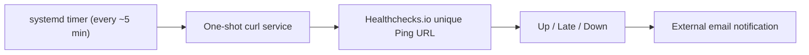

# JuanCloud v3 — External heartbeat monitoring

## Why it exists

A monitoring process running on JuanCloud cannot send an alert if the Raspberry Pi is powered off or disconnected from the internet. Healthchecks.io independently tracks the last outbound heartbeat and sends an email if the expected ping does not arrive.

This is **external liveness monitoring of the heartbeat job**, not a complete Nextcloud availability check. It cannot identify every partial outage where outbound HTTPS remains available but Nextcloud fails.

## Architecture



## Implemented configuration

- Check name: **JuanCloud - Server Heartbeat**.
- Healthchecks.io simple schedule: **5-minute period, 5-minute grace**.
- Pi unit names: `juancloud-heartbeat.service` and `.timer`.
- Root-only curl configuration: `/etc/juancloud-heartbeat/curl.conf` with `0600` permissions in a root-owned directory.
- curl flags: `fail`, `silent`, `show-error`, `connect-timeout=10`, `max-time=20`, `retry=2`, output discarded.
- systemd unit uses `Type=oneshot`, `NoNewPrivileges`, `PrivateTmp`, `ProtectSystem=strict`, and `ProtectHome`.
- The unique Ping URL is intentionally **not stored in the GitHub repository**.

Public unit-file copies live in [`../systemd/`](../systemd/). Keep a real Ping URL only in a secure local config file.

## Setup and verification

```bash
sudo install -d -m 700 /etc/juancloud-heartbeat
sudo install -m 600 /dev/null /etc/juancloud-heartbeat/curl.conf
sudo nano /etc/juancloud-heartbeat/curl.conf
```

Example shape of the **private** file (do not commit this file, and replace the placeholder locally):

```ini
url = "https://hc-ping.com/YOUR-PRIVATE-CHECK-ID"
fail
silent
show-error
connect-timeout = 10
max-time = 20
retry = 2
output = "/dev/null"
```

Deploy the systemd unit files from `systemd/` to `/etc/systemd/system/` after review, then:

```bash
sudo systemctl daemon-reload
sudo systemctl enable --now juancloud-heartbeat.timer
sudo systemctl start juancloud-heartbeat.service
sudo systemctl show juancloud-heartbeat.service -p Result -p ExecMainStatus
sudo systemctl list-timers --all | grep juancloud-heartbeat
```

Expected after a successful ping: `Result=success` and `ExecMainStatus=0`. The check dashboard must also display a recent ping. Successful `systemctl` results alone do not prove that the external provider processed the event.

## Completed fault-injection drill — October 26, 2026

1. An initial heartbeat attempt failed with `curl: (3) URL rejected: Malformed input to a URL function`. Correcting the local Ping URL resolved the problem.
2. A successful heartbeat appeared in Healthchecks.io (screenshot showed a ping received nine seconds earlier).
3. Stopped **only** the `juancloud-heartbeat.timer`, keeping production services online.
4. After the period and grace time, the check progressed to **Late** and **Down**.
5. Healthchecks.io delivered the actual **DOWN notification email**, which the user showed in the chat. The email reported the missing success ping after the grace period.
6. Restarted the timer and triggered the service manually. Final Pi output: `active`, `Result=success`, `ExecMainStatus=0`, with a next heartbeat scheduled. A screenshot of the post-recovery green Healthchecks status was not separately recorded.

To repeat the low-risk alert drill:

```bash
sudo systemctl stop juancloud-heartbeat.timer
sudo systemctl is-active juancloud-heartbeat.timer # expect inactive
# Check the provider's Late/Down status and email notification.
sudo systemctl start juancloud-heartbeat.timer
sudo systemctl start juancloud-heartbeat.service
sudo systemctl show juancloud-heartbeat.service -p Result -p ExecMainStatus
```

**Never stop the production Nextcloud stack to simulate this alert.** The outage drill intentionally disables heartbeat delivery only.

## Limitations and next improvements

- Typical detection with a 5-minute period plus 5-minute grace is around **10 minutes from the last successful ping**, plus provider processing/email-delivery time; not a contractual guarantee.
- Heartbeat pings are scheduled approximately every five minutes from service activation, with systemd timer accuracy and scheduling jitter.
- A broken local timer, loss of power, loss of internet egress, or invalid URL can all result in a missed ping. The alert alone does not identify the root cause.
- Add a separate HTTP endpoint check for Nextcloud and an optional backup-freshness check; keep access private and avoid disclosing private URLs or account credentials.
- Monitoring configuration, notification destinations, and the secret Ping URL should be documented in a secure off-server recovery vault, not a public Git repo.
