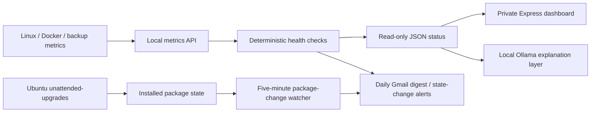

# JuanCloud v2 — Monitoring and Automated Maintenance

## Objective

Build operational visibility for a private Raspberry Pi 5 home server without adding a heavy observability stack or trusting a language model to make health decisions.

## Design



The Ollama assistant summarizes or explains monitored findings; it does not decide alert severity or install updates. The update watcher observes packages but never changes them.

## Verified health checks

| Signal | Verification and interpretation |
|---|---|
| CPU temperature | Raspberry Pi temperature; warning at 80°C and critical at 85°C |
| Available memory | Warning below 0.75 GiB; critical below 0.35 GiB |
| Main and backup disk capacity | Warning at 85% usage; critical at 95% usage |
| Docker containers | Missing/stopped/unhealthy critical; an unconfigured health check is not itself a failure |
| Backup execution | Last result, timer enabled/active, and backup age; success is **not** a restore test |
| Pending APT packages | Names/count from local APT metadata; not proof that packages can all be installed unattended |
| Reboot indicator | Linux `/var/run/reboot-required` flag |

The monitoring daemon records measurements in `/var/lib/juancloud-health` and exposes a restricted health report to the dashboard. A systemd timer checks health every ~10 minutes. The daily email digest is scheduled for 8 AM America/New_York. Actual timer times should be checked on the target machine.

## Automatic Ubuntu maintenance

Ubuntu 24.04's `unattended-upgrades` installs eligible security and stable `-updates` packages. Package-list refresh and upgrade timers run daily. **Automatic reboot is disabled**, although some package upgrades may restart individual services. Manual `apt upgrade` is still needed for some packages, particularly third-party sources or held packages.

Verify without modifying packages:

```bash
systemctl list-timers --all | grep -E 'apt-daily|juancloud'
sudo unattended-upgrade --dry-run -v
apt list --upgradable
```

## Per-update email notifications

`monitoring/update-notifier.py` (included only after exporting the file from the live server) detects installed package version changes and emails a consolidated summary. Each email can contain upgrades, added/removed packages, remaining APT updates, and reboot status. It establishes an initial package baseline and only advances the baseline following successful email delivery, so SMTP failures can be retried. It does not update packages.

The notifier is separate from the daily health report. A code snapshot is not proof the systemd timer is installed or sending email; validate it on the server:

```bash
systemctl list-timers --all | grep juancloud-update
sudo systemctl start juancloud-update-notify-test.service
sudo journalctl -u juancloud-update-notify-test.service -n 20 --no-pager
```

## Email delivery and secrets

Gmail SMTP uses a Google app password obtained locally, never committed to Git. Secrets are stored in `/etc/juancloud-health.env` on the Pi. The public repository must contain **no** copies of that file or screenshots revealing credentials or account identifiers. The email formats include a text fallback and an HTML version with green/orange/red severity cues.

## Design limitations and follow-ups

- Dashboard update counts may lag due to a six-hour application cache and locally cached APT metadata. Display both the value and its `checkedAt` timestamp.
- The Pi cannot report being offline by emailing from itself. An independent external heartbeat service would address this.
- Monitoring signals are only as complete as the available collectors; unknown readings should not be silently converted to success.
- Neither this system nor a successful backup email proves full disaster recovery. Conduct a documented restore test.
- The APT watcher does not monitor Docker image upgrades, Snap packages, or Ollama model downloads.
- Deploying new code and restarting services should remain a separate, reviewed maintenance operation.

## Skills demonstrated

Linux administration, Bash/Python automation, Node.js/Express, REST APIs, Docker, systemd services/timers, SMTP/TLS, operational monitoring, secure remote access, production troubleshooting, and technical documentation.
